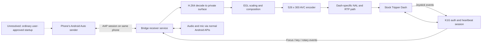

# Candidate bridge architecture

This is a design for investigation, not an implemented app. Full Android Auto remains the goal.

## Runtime ownership

One user-started foreground service owns the receiver, encoder/decoder, K1G session, Wi-Fi request and callbacks, input mapping, and cancellation. The Activity configures and observes that service. Putting the streaming owner in an Activity or ViewModel recreates the lifecycle problem we are trying to remove.

The implementation should render to private surfaces, not MediaProjection, overlays, accessibility scraping or a permanently visible phone Activity. Start services requiring while-in-use permissions from visible UI and follow current foreground-service rules. Hold only the locks needed by the active ride, release them on stop/error, and show an explicit ongoing session notification.

## Networking

The bike's stock Wi-Fi remains the dash transport. Bind **dash sockets individually** to that network. Binding the entire process to the bike's no-internet network would also redirect route, map, account and other internet requests incorrectly. Keep cellular routing available.

QR/WPP is a candidate to bootstrap the sender. It must use honest device/network information and the ordinary Android Auto consent UI. No developer-server requirement, private component enabling, fake network objects, root, privileged shell, or modified sender APK may be silently introduced to make it pass.

Prove bootstrap before implementing the full receiver. An app icon, an exported component, or a successful TCP connection alone is not a full Android Auto session.

## Video and the round display

Android Auto sends display-oriented video at its negotiated resolution. The bike's observed map stream is 526 x 300 at roughly 2–4 fps. Repacketizing an arbitrary Android Auto H.264 stream is not sufficient: resolution, profile, parameter sets, frame pacing and the dash decoder's expectations must all match.

The likely pipeline is decode -> GPU compose/scale -> encode -> dash-specific NAL/RTP. Preserve aspect ratio and keep essential Android Auto controls inside the usable area. The dashboard draws its own chrome and clips the visible region; the encoded rectangle is not the same as an unobstructed rectangular head-unit screen. Native Android Auto layout and joystick focus usability remain validation tasks. Four fps may also be inadequate for some interface transitions.

## Input and audio

A complete bridge needs more than a map image. Translate acknowledged dash joystick events into Android Auto-supported key/focus/rotary input. Button meanings may vary with the dash mode and firmware. Avoid synthesizing touch coordinates as the only input model.

Negotiate audio routes deliberately. Phone, receiver and helmet must not create duplicate playback, microphone feedback, or broken call routing. Prefer normal audio APIs and ordinary user permissions. No assertion that this works while locked follows from having video frames alone.

## Evidence gates before an app release

1. **Bootstrap:** demonstrate a same-phone Android Auto AAP session from ordinary app UI, with no excluded phone changes. Confirm the QR feature and genuine device-presence prerequisites. An Android device/runtime can settle these phone-side questions without a bike if a faithful peer is available; a static read cannot establish server-delivered flags or successful runtime negotiation.
2. **Off-screen receiver:** finish a real AAP session and continuously decode/composite/encode with the display locked; keep a monotonic diagnostic counter independent of Activity lifecycle.
3. **Stock dash transport:** preserve authenticated control sequencing and decoder/button ACKs; validate fresh start, stop, reconnect, and dash-mode changes.
4. **Complete interface:** establish reachable controls, readable text, audio, microphone and call routing.
5. **Compatibility:** record Android version, Android Auto version, phone vendor, app build and dash firmware. “Supports Android Auto” alone does not establish support for a same-phone translating receiver.

## Licensing and future CarPlay

The existing dash-side references are Apache-2.0; Open Headunit is AGPL-3.0. Their code must retain its obligations if reused in a combined implementation. This repository currently contains original research tools and links, not a relicensed receiver codebase. The iOS TripperDash++ reference is noncommercial source-available, so it must not be copied into an unrestricted open-source app without resolving its terms.

CarPlay should be a separate workstream. An iOS app sending its own map frames to the dash does not mean an iPhone can host its own CarPlay receiver or start a CarPlay session for this bike.
